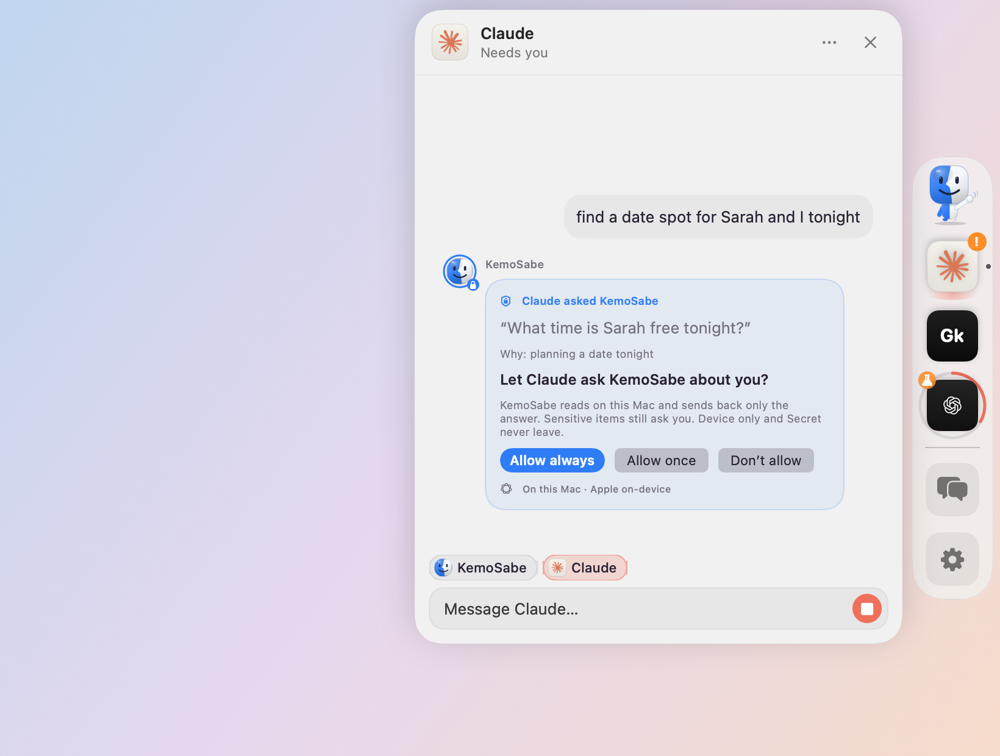
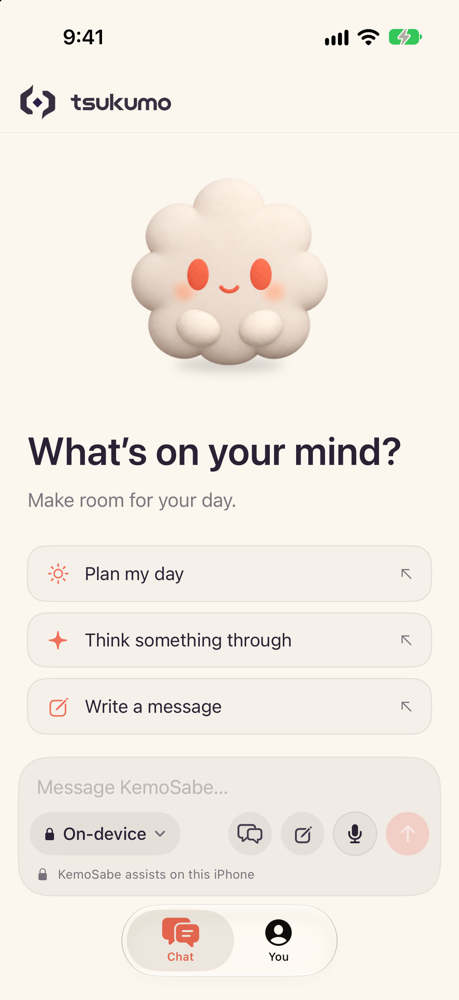
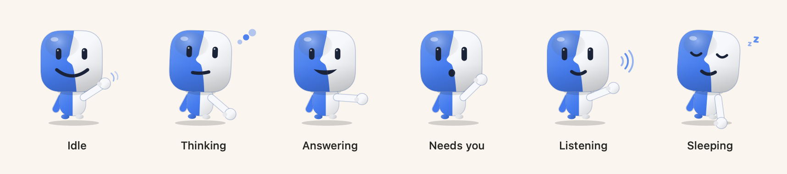

# Tsukumo

**All your AI bots in one place, with a guard on your device that keeps your personal life there.**

  <picture>
    <source media="(prefers-color-scheme: dark)" srcset="design/mac-preview/side-dock-dark.png">
    
  </picture>

You probably talk to more than one AI: Claude for one thing, ChatGPT for another, Apple's on-device model for quick questions. Each lives in its own app, and when one of them needs something personal, like whether you're free tonight, the usual answer is to hand it your calendar or your messages.

Tsukumo puts your bots side by side and gives them a guard. When a bot needs something about you, it can't go looking. It asks **KemoSabe**, the bot that lives on your device. KemoSabe reads there with Apple's on-device model and hands over only the answer, and only with your say-so.

## What it does

### Your bots, together

- **Bring them or make them.** Add your ChatGPT dot, Tsukumo's Claude bot, or an agent like Grok, OpenClaw, or Meta's Muse. Or make your own on Claude or OpenAI with your API key, or on Claude Code, Codex, Cursor Agent, or Gemini CLI with your own sign-in. Any bot can wear one of your Codex pets.
- **One chat or many.** Each bot has its own conversation, and Together puts them all in one thread. Tag a bot with `@name`, or let Tsukumo pick who answers, starting on your device.
- **Talk out loud.** Click a bot in the dock (on iPhone, tap the microphone) and say what you need. It answers in its own voice, and speech stays on your device.
- **Work in the background.** Give Tsukumo's Claude bot a goal, now or on a schedule, and it works while you do something else. Its tile shows when it needs you or is done.
- **Coding bots that ask first.** A coding bot works in a folder you pick, read only unless you allow more, and can open what it edits in Xcode, Cursor, VS Code, or Zed.

### KemoSabe keeps your life on your device

- **Bots ask, KemoSabe answers.** No bot reads your calendar, messages, or files itself. The first time one asks, you choose Allow always, Allow once, or Don't allow, and a card in the chat shows what was shared and what stayed put.
- **You pick the sources.** Calendar, Reminders, Contacts, Messages, Photos, the folders you choose, Location and Music on iPhone, and any service with an MCP server. Each is off until you turn it on, and anything you mark Device only is never read for a bot.
- **Outside services ask too.** On a Mac, turn on the gateway and services like Claude Code, Codex, Grok, ChatGPT, and Muse can ask KemoSabe for your free/busy times, a contact, or a file you allow. Each signs in once, and Revoke is one click away.
- **One activity feed.** Everything KemoSabe answered or refused, and what your bots did.
- **Your keys stay yours.** API keys are kept in that device's Keychain.

### Made to fit

- **A dock that's yours.** On a Mac, your bots live in a side dock beside macOS's own. Pick its style, color, size, and spot with a live preview, and find Settings one click away at its foot.
- **KemoSabe your way.** A friendly cloud or a two-tone figure with a wave, in twenty-one palettes.
- **Updates itself.** New versions install only after they're confirmed as signed by the developer and notarized by Apple.

  <picture>
    <source media="(prefers-color-scheme: dark)" srcset="design/onboarding/iphone-4-chat-dark.png">
    
  </picture>
  &nbsp;&nbsp;
  <picture>
    <source media="(prefers-color-scheme: dark)" srcset="design/mac-settings/mac-kemosabe-states-dark.png">
    
  </picture>

## Get it

| | What you get | Needs | Available |
|---|---|---|---|
| **Mac** | Tsukumo's Dock: your bots in a dock at the edge of the screen, from the menu bar | macOS 26 on a Mac with Apple Intelligence | Not yet |
| **iPhone** | The Tsukumo app: the same bots in one chat | iOS 26, and Apple Intelligence for KemoSabe | Coming soon |

## Getting started

Open Tsukumo and a short first run walks you through signing in (or continuing without an account) and connecting what you use. Then the dock appears with KemoSabe in it. Click **+** to add a bot, click a bot to talk to it, and click the gear at the dock's foot for Settings.

## Under the hood

Tsukumo is written in Swift on a shared package, TsukumoKit. [DEVELOPMENT.md](DEVELOPMENT.md) covers building and running it, and [docs/ARCHITECTURE.md](docs/ARCHITECTURE.md) explains how it fits together. The two apps that came before it, the Tsukumo coding harness for Mac and the KemoSabe iPhone app, are kept in [legacy/](legacy/README.md) for reference.
