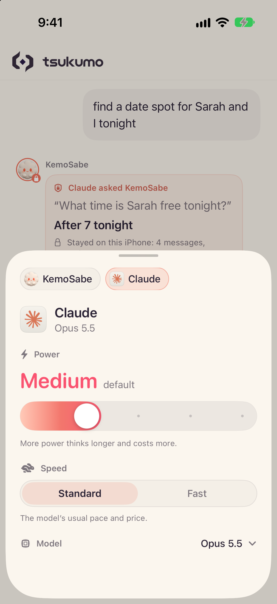
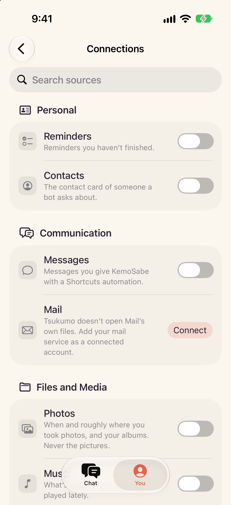

# Tsukumo

**All your AI bots in one chat on your iPhone, with a guard on the phone that keeps your personal life there.**

  <picture>
    <source media="(prefers-color-scheme: dark)" srcset="design/onboarding/iphone-4-chat-dark.png">
    
  </picture>

You probably talk to more than one AI: Claude for one thing, ChatGPT for another, Apple's on-device model for quick questions. Each lives in its own app, and when one of them needs something personal, like whether a friend said they're free tonight, the usual answer is to hand it your messages.

Tsukumo puts your bots side by side and gives them a guard. When a bot needs something about you, it can't go looking. It asks **KemoSabe**, the bot that lives on your iPhone. KemoSabe reads there with Apple's on-device model and hands over only the answer, and only with your say-so.

## What it does

### Your bots, together

- **Bring your own models.** Add a Claude or OpenAI key and that service's bot joins KemoSabe in the chat. Or make your own bot: give it a name, a job, and what it should know, and pick what it runs on.
- **One chat for all of them.** Tag a bot with a tap or `@name`, or keep talking to the last one, and let Tsukumo pick who answers when you don't. Your chats come up from the bottom of the screen, one thumb away.
- **Pick the power.** Tap the model under the message box to choose a bot's model, how hard it thinks, and, on Claude Opus, Fast for quicker answers.
- **Characters.** Any bot can wear one of Tsukumo's own characters: Lobster, Brain, Octopus, Fox, Cat, Penguin, or Frog.
- **Talk out loud.** Tap the microphone or hold a bot's chip and say what you need. It answers in its own voice, and speech stays on your iPhone.

### KemoSabe keeps your life on your iPhone

- **Bots ask, KemoSabe answers.** No bot reads your messages or files itself. The first time one asks, you choose Allow always, Allow once, or Don't allow, and a card in the chat shows what was shared and what stayed put.
- **You pick the sources.** Reminders, Contacts, Messages you give it, Photos details, the files and folders you choose, Location, Music, and any service with an MCP server. Each is off until you turn it on, and anything you mark Device only is never read for a bot.
- **One activity feed.** Everything KemoSabe answered or refused, and what your bots did.
- **Your keys stay yours.** API keys are kept in your iPhone's Keychain, never synced or backed up.

  <picture>
    <source media="(prefers-color-scheme: dark)" srcset="design/bot-customization/iphone-model-sheet-dark.png">
    
  </picture>
  &nbsp;&nbsp;
  <picture>
    <source media="(prefers-color-scheme: dark)" srcset="design/onboarding/iphone-kemosabe-sources-dark.png">
    
  </picture>

## Get it

Tsukumo for iPhone is coming soon. It needs iOS 26, and an iPhone with Apple Intelligence for KemoSabe.

## Getting started

Open Tsukumo and a short first run walks you through connecting your AIs (your Claude or OpenAI key) and then your life: what KemoSabe may read, and any connectors. Then you're in the chat with KemoSabe. Tap **See how KemoSabe works** to watch another AI ask KemoSabe something, on sample chats, and decide what it may share. Your bots, keys, and everything else are in Settings, under your picture and name.

## Under the hood

Tsukumo is written in Swift on a shared package, TsukumoKit. [DEVELOPMENT.md](DEVELOPMENT.md) covers building and running it, and [docs/ARCHITECTURE.md](docs/ARCHITECTURE.md) explains how it fits together.
